<p align="center">
  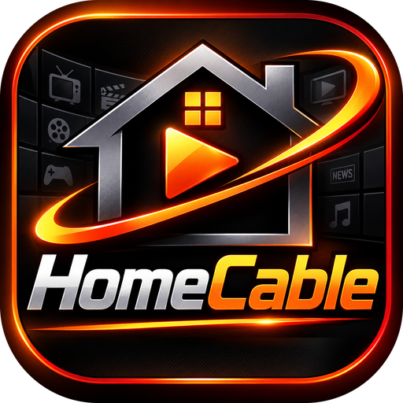
</p>

<h1 align="center">HomeCable</h1>
<p align="center"><b>Your videos. Live, like cable.</b></p>

<p align="center">
  <a href="https://github.com/OrionVW42/homecable/releases/latest"></a>
  
  
</p>

HomeCable turns the shows, movies and music you already own into **real TV channels**: a schedule that never stops, a cable-style guide, channel surfing, pause & rewind — plus On Demand movie walls, binge-ready shows, free live TV, casting to the TV, and a phone app for the whole house.

Free and open source (MIT). No accounts, no telemetry, no tracking. It's a player: you bring the media, and what you play is your responsibility — see [License & fair use](#license--fair-use).

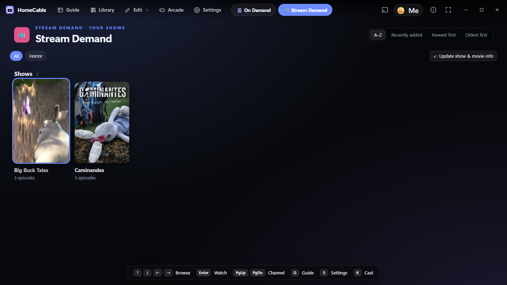

## Why

Streaming menus turned watching TV into homework. HomeCable brings back the other way: channels that are already playing something, a guide to flip through, and the couch feeling of just watching TV — built from your own library, on your own hardware, answering to no one.

## See it move

| | |
|---|---|
| 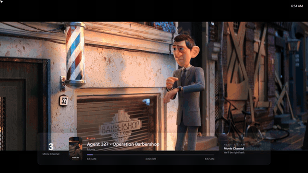 | 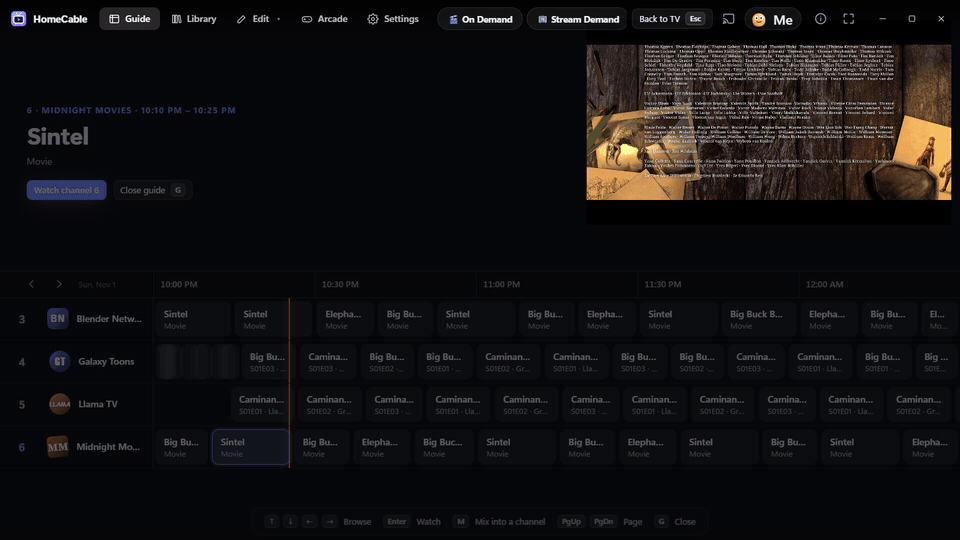 |
| *Flip channels — you join shows in progress, like real TV* | *The guide: what's on, everywhere, now* |
| 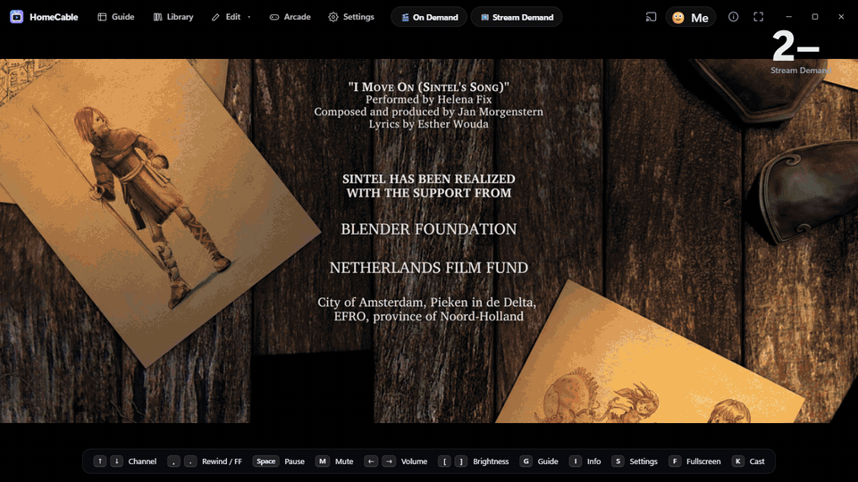 |  |
| *Stream Demand: the next episode plays itself* | *Show ends → channel bumper → wacky ad → next show* |

## What it does

- **Channels that run like cable.** Shows start on the half hour, episodes air in order (or shuffled, or fully random — your pick per channel), and channels keep airing even while the app is closed — open it next week and the schedule has moved on, exactly on time. Time blocks air specific shows at specific times ("Saturday Cartoons 8–11am").
- **Network logos & channel bumpers.** Every channel gets its own network mark — ready-made looks (fonts, badge shapes, colors; long names become cable-style acronyms) or your own picture. Between shows the channel plays a few seconds of its own animated logo bump, just like real networks.
- **On Demand & Stream Demand.** A wall of your movie posters (pick one, resume where you stopped) and a Netflix-style shows screen — seasons, episodes, "Continue S2 · E4", with OVAs and specials in true airing order.
- **Live DVR.** Pause, rewind and fast-forward live channels like a cable box.
- **The Edit menu.** Manage any channel in one place: add shows and movies (with suggestions that fit what it already plays), name, number, logo, order, timing — with a live cable-strip preview. Plus a Tags page with one-click **auto-tag everything**: posters, genres, corrected names, anime detection (Shounen, Isekai, Mecha…), airing order — titles only are ever sent.
- **Wacky commercial breaks (off by default).** Short, family-friendly interdimensional joke ads ship inside the app. Add your own **ad packs** — a pack is just a folder of short videos, each with its own switch. Ads only ever play in breaks, never in your library.
- **Watch all over the house.** Cast to Chromecast / Google TV (mirror everything or send just the picture). Pair phones and tablets with a QR code — watch anywhere on your network, or use one as the remote, even for the TV.
- **Profiles & a locked section.** Kids see kid-friendly channels only; PIN/password/controller-combo locks; plus a password-locked private section kept out of every list, search and guide.
- **Subtitles & dubs, Netflix-style.** Auto-subtitles when the audio isn't your language, per-show memory, anime skip-intro, and live captions generated entirely on your PC.
- **Free TV with a real guide — thousands of stations.** Over 10,000 free, publicly available live stations worldwide from the community-run [iptv-org](https://github.com/iptv-org/iptv) index: pick languages, countries and whole regions, no station limits, every one auto-tested so only working ones are kept — with real programme names and times from free public XMLTV guides. Plus public-domain classics from the Internet Archive.
- **Plays anything.** MP4, MKV, AVI, WMV, MOV, MPEG, TS, FLV, HEVC… converted on the fly by bundled FFmpeg when needed.
- **Finds your media.** This PC, USB, network shares, NAS boxes and DLNA servers (Plex, Jellyfin, Emby…). New files appear on channels automatically — or wait for your review, your choice.
- **Couch-first.** Keyboard, mouse, Xbox / PS5 controllers, fullscreen TV mode, pop-out mini player, a one-time welcome tour, and four retro arcade games.
- **Keeps itself up to date.** New versions come straight from GitHub Releases: downloaded quietly in the background, installed on the next start, channels and settings always kept.

## Screens

| | | |
|---|---|---|
| 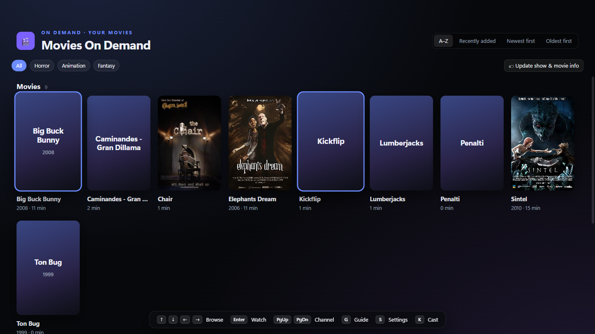 | 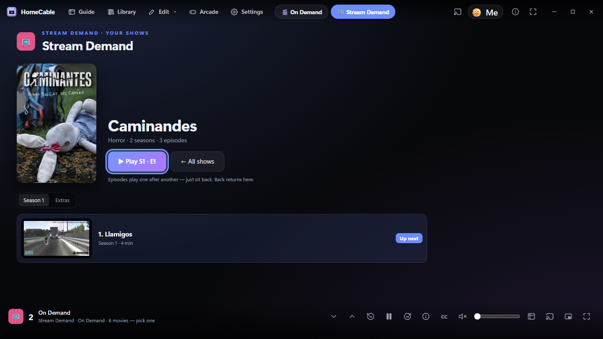 | 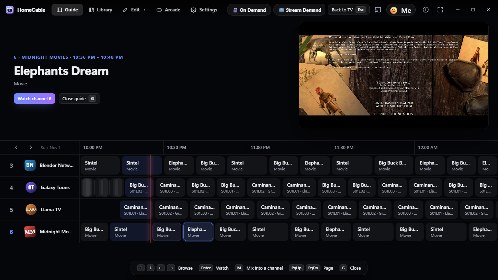 |
| 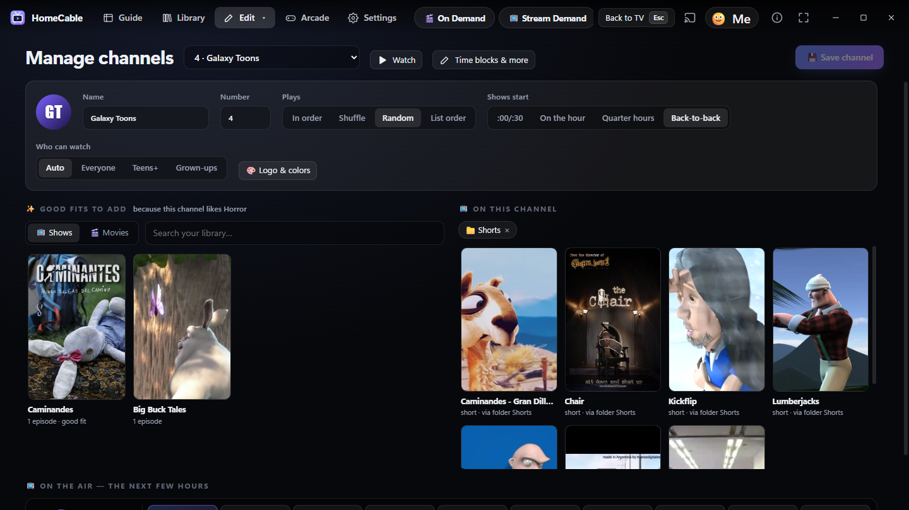 | 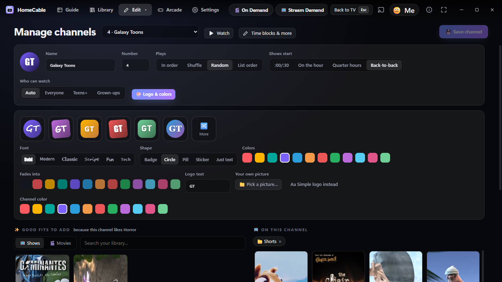 | 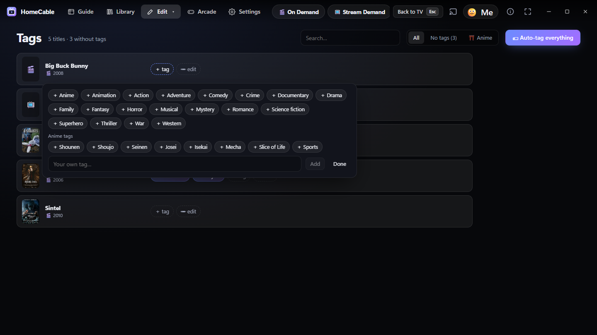 |
| 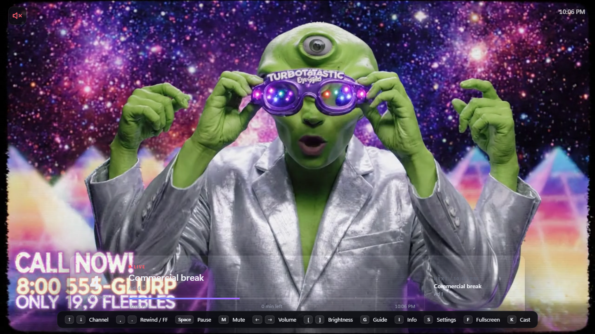 | 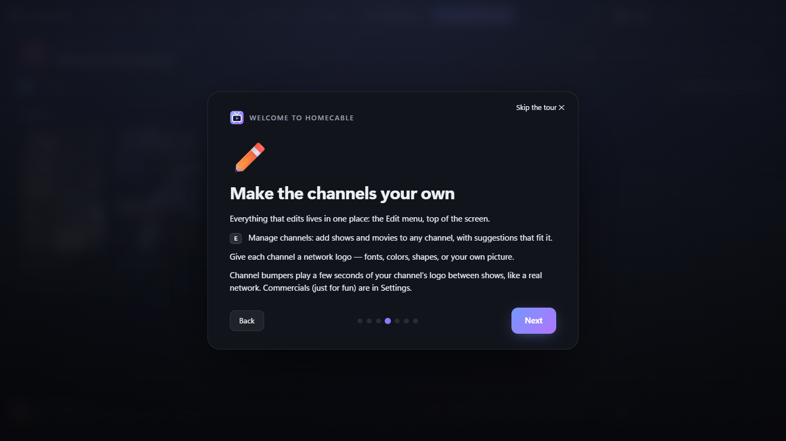 | 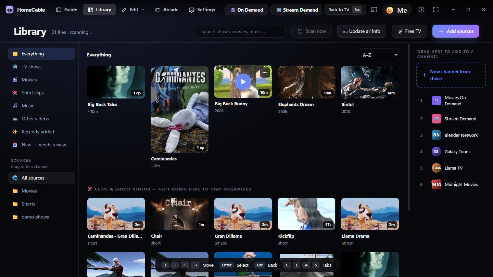 |

## Install

1. Download `HomeCable-Setup-<version>.exe` from [Releases](https://github.com/OrionVW42/homecable/releases/latest) and run it. The installer asks you to agree to the fair-use terms — it won't install without them.
2. On first launch pick **Set it all up for me** — HomeCable finds your media, builds channels, adds free TV and shows you around. Or **I'll do it myself** and place everything by hand.
3. From then on HomeCable **updates itself**: it checks these Releases, downloads the new version quietly without interrupting what's playing, and switches over the next time it starts — channels, people and settings are always kept. (Running a newer installer by hand works too.)

> **Note:** the installer is not code-signed yet, so Windows SmartScreen may warn on first run — *More info → Run anyway*. Code signing is on the roadmap.

**Phones:** Settings → Phone app → pair with the QR code. Requirements: Windows 10/11 64-bit; Android 8+ for the companion APK.

## Platforms

| Platform | Status |
|---|---|
| Windows 10/11 (x64) | ✅ Full app |
| Android phone / tablet | ✅ Companion APK (pairs to your PC) |
| Chromecast / Google TV | ✅ Casting |
| Fire TV / Android TV | 🔜 Roadmap |
| iOS | 🔮 Future |

## Roadmap

- **Fire TV / Android TV app** — D-pad-first, paired to the PC like phones.
- **Phone APK updates served from the paired PC.**
- **Code signing** — no more SmartScreen warning.
- **iOS** — future; not started.

## Remote

Works with the keyboard, the mouse, and Xbox or PS5 controllers (Bluetooth or USB). A strip at the bottom shows the buttons for whatever you used last; **Settings → Controls** has the full map for each.

| | Keyboard | Xbox | PS5 |
|---|---|---|---|
| Channel down / up | ↓ ↑ | LB / RB | L1 / R1 |
| Rewind / fast-forward | , . | LT / RT | L2 / R2 |
| Pause | Space | X | □ |
| Mute | M | B | ○ |
| Volume | ← → | D-pad ↓ ↑ | D-pad ↓ ↑ |
| Brightness | [ ] | D-pad ← → | D-pad ← → |
| Guide | G | Menu | Options |
| What's on | I | A | ✕ |
| Menus | C · L · S | Y | △ |
| Fullscreen | F (Esc leaves) | View | Create |
| Picture size | Z | R3 | R3 |
| Previous channel | Backspace | L3 | L3 |
| Arcade | A | Y → Arcade tab | △ → Arcade tab |

## Build from source

```
npm install
npm start        # run from source
npm test         # unit tests
npm run dist     # build dist/HomeCable-Setup-<version>.exe
```

End-to-end tests drive the real app with Playwright — see the repo's test files. Settings, channels and the library live in `%APPDATA%\HomeCable\` (kept across reinstalls).

## Privacy

No accounts, no telemetry, no tracking. HomeCable only goes online for optional features (show info by title, free TV, guides, hosted ad packs), and nothing is ever opened to the public internet — away from home it works only through a VPN you run yourself. [NOTICES.md](NOTICES.md) lists exactly what it contacts and every bundled license.

## Contributing

Issues, ideas and pull requests welcome. If you build something fun — an ad pack, a great channel look, a theme of channels — share it in Discussions.

## Thanks

HomeCable's free live TV is built on [**iptv-org**](https://github.com/iptv-org/iptv) — a community-run, always-updating index of thousands of publicly available IPTV stations, kept alive by its maintainers and hundreds of contributors. Thank you for keeping free TV free. Thanks also to the free public XMLTV guide sources ([epg.pw](https://epg.pw), [i.mjh.nz](https://i.mjh.nz)), the [Internet Archive](https://archive.org) for the public-domain classics, and [TVmaze](https://www.tvmaze.com) & [Wikipedia](https://www.wikipedia.org) for show & movie info.

## License & fair use

MIT — see [LICENSE](LICENSE). HomeCable hosts, provides, sells and endorses no media. You are solely responsible for the content you play and for having the right to play it; the app is **not** intended for piracy or any unlawful use, and installing it means agreeing to that. Provided "as is", without warranty. Bundled third-party components (FFmpeg under GPL v3, Electron, whisper.cpp and others) keep their own licenses — see [NOTICES.md](NOTICES.md).
